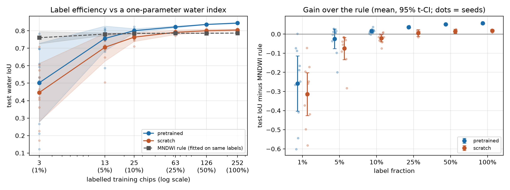

# When is a spectral index enough? Label efficiency of a geospatial foundation model for surface-water mapping

**Status: work in progress.** The experiments below are complete; analysis is ongoing and a write-up is in preparation. Results may change as the analysis is finalised.

Geospatial foundation models are often described as label-efficient, but they are rarely tested against a strong, simple baseline across a range of label budgets, or checked for whether regional performance gaps come from the model or from the data. This repository asks:

1. **When is a one-parameter spectral index enough**, and when does a geospatial foundation model earn its cost?
2. **How much does pre-training help** compared with the same architecture trained from scratch, and does it help more in under-represented regions?
3. **Is a frozen encoder enough**, or does the whole model need fine-tuning?

## Setup

| | |
|---|---|
| Data | [Sen1Floods11](https://github.com/cloudtostreet/Sen1Floods11) hand-labelled Sentinel-2 chips (train 252, test 90, plus the held-out Bolivia event); six bands: B2, B3, B4, B8A, B11, B12 |
| Model | Prithvi-EO-2.0 (100M, `terratorch_prithvi_eo_v2_100_tl`) through [TerraTorch](https://github.com/IBM/terratorch), with a multi-level segmentation decoder |
| Arms | **pretrained** encoder vs the **same architecture from scratch**; also a **frozen encoder** with a trainable decoder, and a **linear probe** |
| Baseline | **MNDWI threshold**, with the threshold fitted on the same label subset as the deep models |
| Label budgets | 1, 5, 10, 25, 50 and 100% of the training chips |
| Seeds | 10 seeds at 1-10%, 5 seeds at 25-100%; each seed selects a different label subset |
| Training | fixed step budget, evaluation at the final checkpoint (no validation-based selection) |
| Regional transfer | leave-Africa-out: train without any chip from Ghana, Nigeria or Somalia, then evaluate on them |

## Results so far



Test water IoU (mean over seeds):

| Labels | Chips | Pretrained | Scratch | MNDWI threshold |
|---|---|---|---|---|
| 1% | 3 | 0.502 | 0.447 | **0.761** |
| 5% | 13 | 0.756 | 0.705 | **0.781** |
| 10% | 25 | **0.801** | 0.763 | 0.785 |
| 100% | 252 | **0.844** | 0.804 | 0.787 |

- **The simple threshold is the better choice with very few labels.** It is ahead of both deep models at 5% of the labels or fewer; the pretrained model leads from 10%.
- **Pre-training helps.** From 5% of the labels upwards, the pretrained model beats the same architecture trained from scratch in every seed, by about 0.03-0.05 IoU on the test split; at 1% the difference is uncertain.
- **A frozen encoder nearly matches full fine-tuning.** With 100% of labels, a frozen encoder with a 0.96-million-parameter decoder reached 0.836 IoU, against 0.844 for full fine-tuning.
- **The lower accuracy on African scenes is largely a data issue.** A data-quality audit traced much of it to one cloud-covered chip (`Ghana_866994`) whose labels cannot be reproduced from optical data. In leave-Africa-out runs, trained without any African chip, the pretrained model was still ahead of the scratch model on the African events (by about 0.02-0.03 IoU), and in the main runs its advantage was similar in Africa and elsewhere.

Full tables: [`figures/summary_tables.md`](figures/summary_tables.md), [`figures/probe_tables.md`](figures/probe_tables.md), [`figures/loao_tables.md`](figures/loao_tables.md), [`figures/event_tables.md`](figures/event_tables.md).

## Limitations

One dataset (Sen1Floods11), optical bands only, and one foundation model. Several African events have few chips, so per-event results are descriptive. The `Ghana_866994` sensitivity analysis was added after the main runs (post hoc).

## Repository structure

```
lepipe/        data loading, label subsets, model (encoder + heads), metrics
scripts/       download, subset generation, training, baseline, analysis
splits/        Sen1Floods11 split lists
subsets/       label subsets for each fraction and seed
results*/      one JSON per run (config and metrics); results_lr2e-5/ is a sensitivity check with a lower encoder learning rate
figures/       figures and summary tables
```

## Reproducing

```bash
conda env create -f environment.yml && conda activate prithvi-le

mkdir -p data && cp -r splits data/splits           # split lists where the scripts expect them
python scripts/download_sen1floods11.py            # hand-labelled chips and labels into data/sen1floods11
python scripts/step4b_make_subsets.py              # label subsets for each fraction and seed

# one run: pretrained or scratch, at a label fraction and seed
python scripts/train.py --init pretrained --fraction 0.1 --seed 0

# or the full queue (stages 1-4: label-efficiency grid; 5: leave-Africa-out; 6: frozen encoder and linear probe)
python scripts/run_queue.py --stages 1 2 3 4

python scripts/baseline_mndwi_subsets.py           # MNDWI threshold on the same subsets
python scripts/analyze_results.py && python scripts/analyze_vs_baseline.py
```

Leave-Africa-out runs use `--exclude-events` with stage 5; frozen-encoder and linear-probe runs use `--freeze-encoder` and `--head linear` with stage 6.

## Author

Vincent Ondeng · [ORCID 0009-0008-0503-0918](https://orcid.org/0009-0008-0503-0918) · vincentondeng@gmail.com
